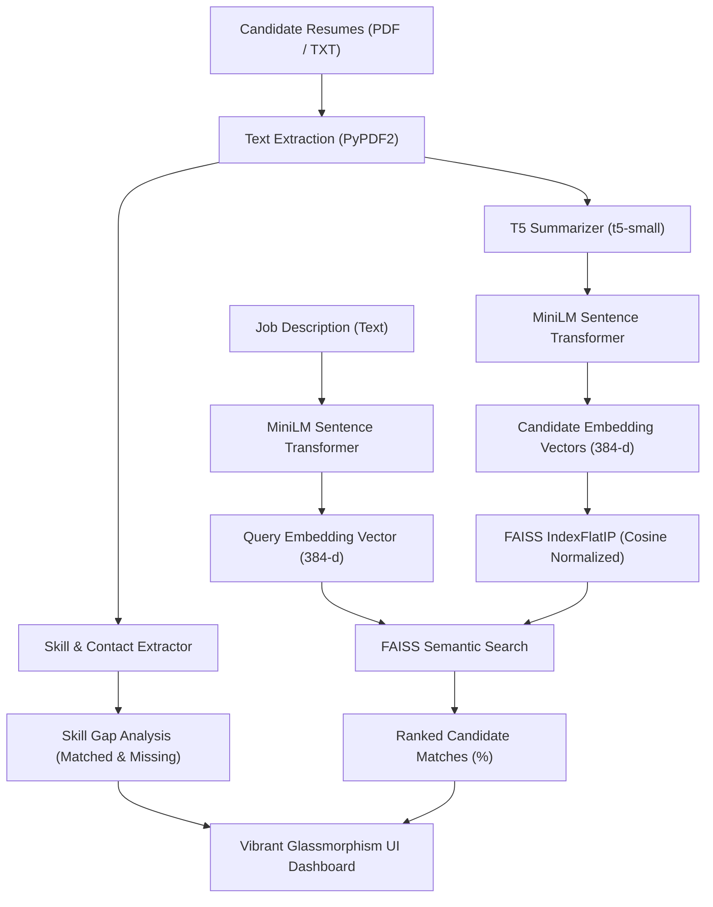

# Resume Screening System: Code Architecture & Technical Guide

This document provides a comprehensive technical overview of the architecture, data pipeline, AI neural models, REST endpoints, and UI components of the AI Resume Screening System.

---

## 1. System Architecture & Processing Pipeline

The application processes unstructured candidate PDF documents and matches them against target job descriptions using high-dimensional vector embeddings and transformer summarization.

### The Pipeline Workflow:
1. **Document Ingestion:** The user inputs a **Job Description** (or chooses a 1-click preset) and uploads one or more **Candidate Resumes** (or uses preloaded sample profiles).
2. **Text & Metadata Extraction:** Raw text is extracted via `PyPDF2` (handling both file streams and paths). Regular expressions extract candidate contact information and match against a technical skill taxonomy.
3. **Neural Summarization (`t5-small`):** Candidate text is passed through the T5 encoder-decoder transformer to generate a concise summary. This standardizes noisy formatting and isolates key experience.
4. **Semantic Embedding (`all-MiniLM-L6-v2`):** Both the Job Description and the AI summaries are mapped into 384-dimensional dense vectors.
5. **Vector Indexing & Cosine Search (`FAISS`):** Candidate vectors are normalized and loaded into a FAISS `IndexFlatIP`. The job description embedding queries the index to calculate cosine similarity.
6. **Dynamic UI Rendering:** Candidates are ranked by match percentage and displayed with glowing radial progress meters, skill pills, executive summaries, and inspection modals.

---

## 2. Code Structure & Modules

### `app.py` (Flask Web Application & API Controller)
- **Background Model Preloading:** Uses a background daemon thread with a threading lock to initialize the heavy neural networks without blocking server startup.
- **REST Endpoints:**
  - `GET /`: Serves the modern glassmorphism web interface.
  - `GET /api/status`: Returns model readiness status and available sample profiles.
  - `POST /api/analyze`: Ingests multipart form data (`job_description`, `resumes`, `min_score`, `use_samples`), triggers the screening pipeline, and returns JSON.
  - `GET /sample_resumes/<filename>`: Allows downloading/inspecting sample PDFs.

### `utils.py` (Neural Engine & Parsing Utilities)
- `load_models()`: Loads the `t5-small` tokenizer/model and `SentenceTransformer('all-MiniLM-L6-v2')`.
- `extract_text_from_file(file_storage, filename)`: Universal extractor supporting PDF streams, raw bytes, and text files.
- `extract_metadata(text, filename)`: Extracts candidate name, email, phone number, and identified skills.
- `analyze_skill_match(candidate_skills, jd_text)`: Identifies required skills from the JD and categorizes them into matched vs. missing skills.
- `summarize_text(summarizer, text)`: Tokenizes and generates summary using T5.
- `embed_texts(embedder, texts)`: Converts text arrays into float32 embedding matrices.
- `create_faiss_index(embeddings)`: L2-normalizes vectors and adds them to `IndexFlatIP`.
- `semantic_search(index, query_embedding, k)`: Performs fast nearest-neighbor retrieval.

### `templates/index.html` & `static/` (Vibrant Cyber-Luminescent UI)
- **Tailwind CSS & Glassmorphism:** Translucent frosted dark panels, dynamic floating ambient glow orbs, and neon gradient buttons.
- **Radial SVG Progress Meters:** Visual circular match score indicators animated to the candidate's exact percentage score.
- **Lucide Icons:** Modern vector iconography.
- **Interactive Controls:**
  - Real-time search filtering across candidate names, skills, and summaries.
  - Dynamic minimum score slider that re-ranks and filters without page reloads.
  - Dual view toggle (Vibrant Card Grid vs. Detailed Comparison Table).
  - One-click export to CSV spreadsheet and JSON format.

---

## 3. AI Models

1. **Summarization: `t5-small` (Hugging Face)**
   - **Parameters:** ~60 Million
   - **Role:** Condenses raw resume text into standardized executive summaries to improve downstream embedding clarity.
   - **Mode:** Local inference on CPU or GPU.

2. **Embeddings: `all-MiniLM-L6-v2` (`sentence-transformers`)**
   - **Architecture:** Distilled BERT (6 layers, 384 dimensions)
   - **Role:** High-speed semantic text representation that understands conceptual synonyms (e.g., mapping "K8s" to "Kubernetes").

3. **Vector Search: Meta `faiss-cpu`**
   - **Algorithm:** Inner Product on L2-normalized vectors (equivalent to Cosine Similarity).
   - **Speed:** Sub-millisecond vector comparison.
